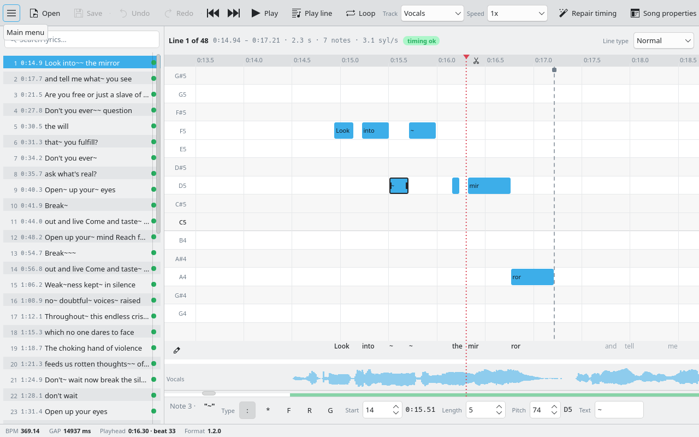
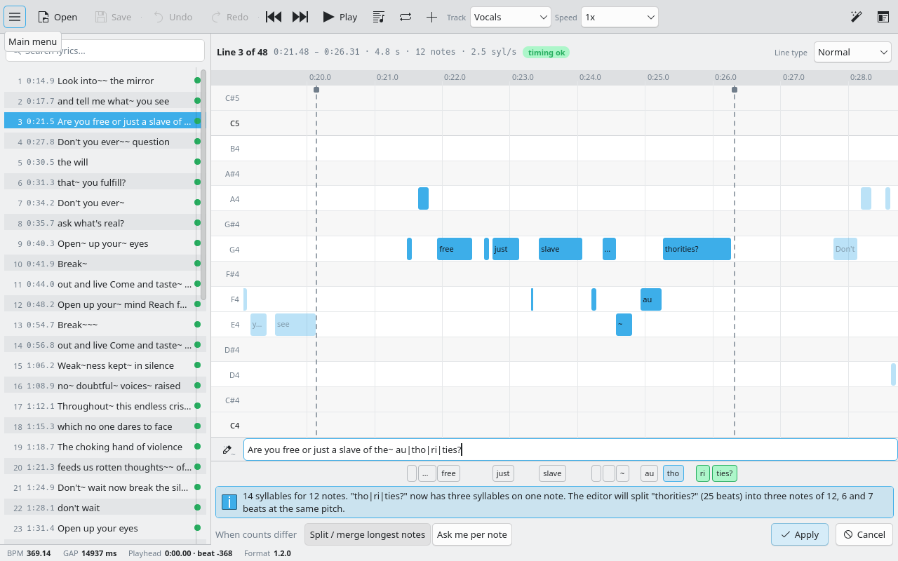
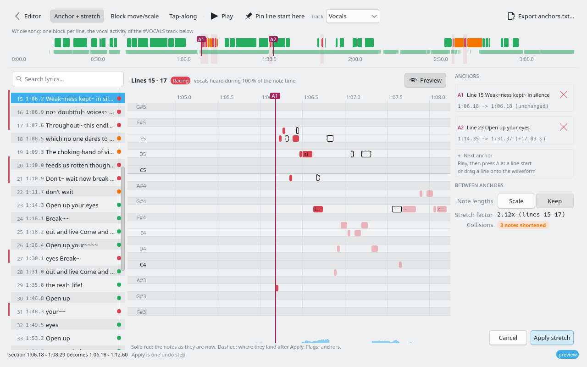
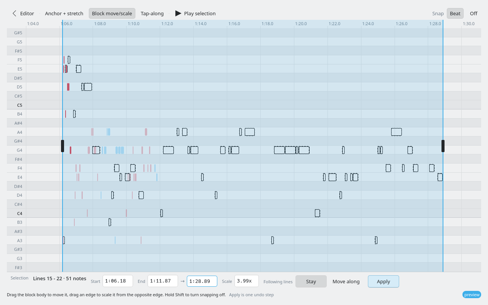
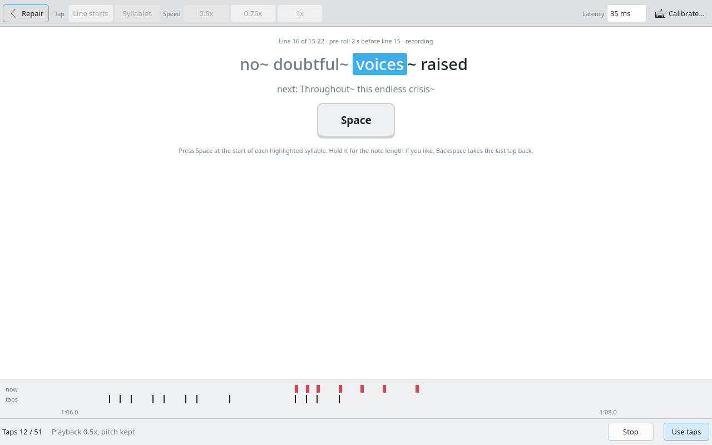
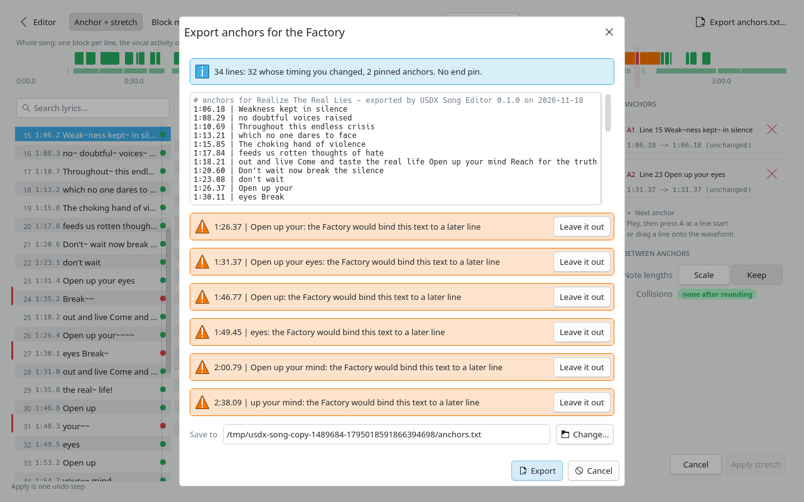
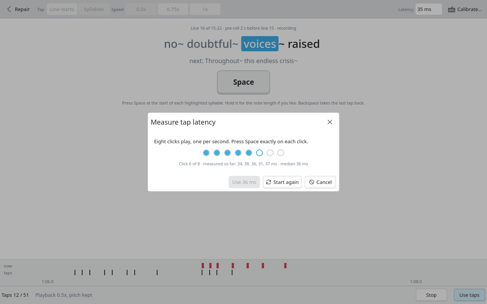
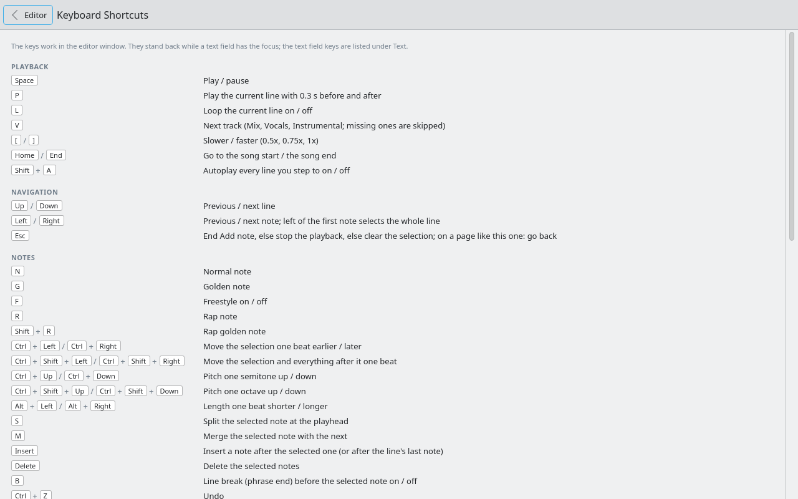
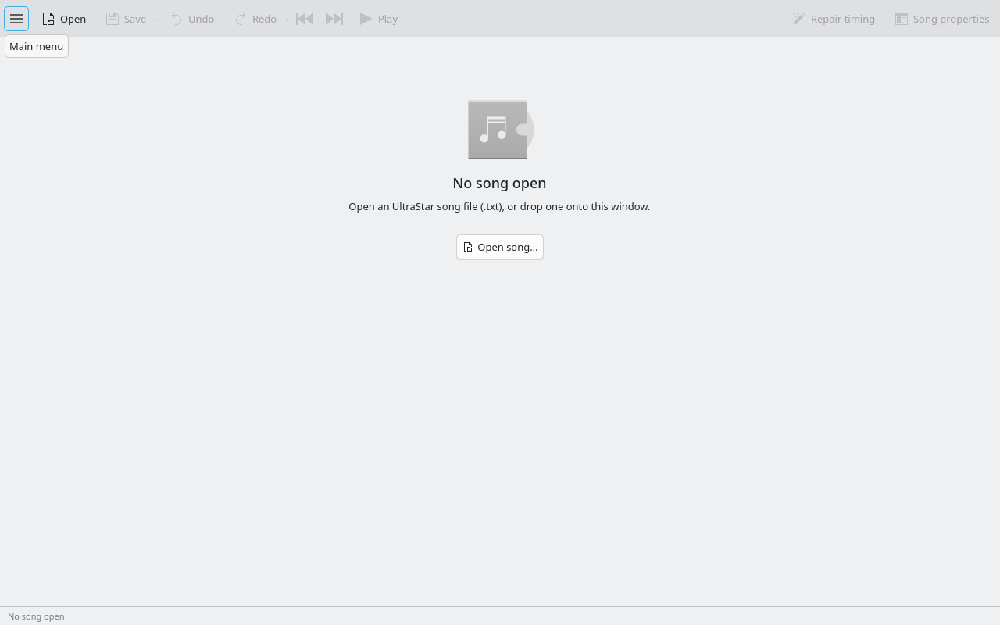

# USDX Song Editor

A desktop application for editing UltraStar Deluxe song files, written in Rust with a
Kirigami (Qt Quick) user interface. It opens a song in the text format that UltraStar
Deluxe sings, shows every lyric line with its notes, and lets you change pitch, length,
type and text with the mouse while listening at the exact spot.

- Application id: `io.github.ueda_ichitaka.UsdxSongEditor`
- Version: 0.1.0 (development)
- Platform: Linux, built for KDE Plasma / Arch Linux
- License: MIT

## Why

UltraStar Deluxe sings what the song file tells it. When a song's notes do not sit on the
beat, the singing feels wrong, and the usual way to fix it - editing the `.txt` file by
hand - is slow and easy to get wrong. Existing tools either rewrite the whole file (losing
comments, encodings and formatting the singer never sees) or work outside the file.

This editor takes the opposite approach: **every change touches the notes in the song file
itself and nothing else.** It reads and writes the format exactly as the format
specification defines it, keeps everything it did not edit byte-identical, and refuses to
invent content. A song that goes through the editor comes out as the same song - repaired.

Where it makes sense it complements the [USDX Song Factory](https://github.com/ueda_ichitaka/USDX-Song-Factory):
the editor can export `anchors.txt` files in the Factory's format as reference data. The
application works standalone, with no Factory, container or network needed.

## Features

- Lossless song model: encodings (UTF-8 with or without BOM, CP1252, CP1250), line
  endings, relative mode, duets, unknown note types and unknown headers all round trip
  byte-identically (verified against a real song corpus).
- Line-by-line navigation with a searchable lines pane, global line numbering across all
  voices, timing health marks for suspicious and racing lines.
- Full editing of notes and headers (pitch, length, type, text, split, merge, insert,
  delete, BPM, GAP) with unlimited undo and redo.
- Playback on the real audio files with mix, vocals and instrumental tracks, at 0.5x to
  1x speed, synced to the note sheet.
- Timing repair: anchor and stretch, block move and scale, tap-along, and a health
  analysis that names every racing line.
- Guarded workflows: unsaved changes are never lost without being asked, a file that
  changed on disk is detected on save and on window focus, and the first save of every
  session writes a `.bak` backup.
- Read-only handling for format versions it cannot write back losslessly.

See `Docs/status.md` for what is already in the current build and what is still on the
workbench.

## Screenshots

The screenshots follow your GitHub theme (light or dark). They are rendered by
`scripts/ui-shots.sh` from the application's demo states.

**Editor**: the lines pane with timing health marks, the note sheet with every syllable in
its note, the lyrics lane, the waveform of the vocals track and the note inspector.

<picture>
  <source media="(prefers-color-scheme: dark)" srcset="Docs/screenshots/editor-dark.png">
  
</picture>

**Line text editor**: the lyrics lane turns into a text field for the whole line; the
preview chips sit under the notes they land on, and a count change is explained before
it is applied.

<picture>
  <source media="(prefers-color-scheme: dark)" srcset="Docs/screenshots/line-text-dark.png">
  
</picture>

**Timing repair, anchor + stretch**: the overview strip marks racing lines, two anchors
stretch the lines between them, the dashed outlines show where the notes land.

<picture>
  <source media="(prefers-color-scheme: dark)" srcset="Docs/screenshots/repair-anchor-dark.png">
  
</picture>

**Timing repair, block move/scale**: a selected block of lines is moved or scaled by
dragging its body or its edges.

<picture>
  <source media="(prefers-color-scheme: dark)" srcset="Docs/screenshots/repair-block-dark.png">
  
</picture>

**Tap-along**: tap the syllables or line starts while the song plays at reduced speed.

<picture>
  <source media="(prefers-color-scheme: dark)" srcset="Docs/screenshots/tap-along-dark.png">
  
</picture>

**Export anchors for the Factory**: the exact `anchors.txt` content with the lines the
Factory would bind to another occurrence.

<picture>
  <source media="(prefers-color-scheme: dark)" srcset="Docs/screenshots/export-anchors-dark.png">
  
</picture>

**Measure tap latency**: eight clicks, one tap each, the median becomes the latency.

<picture>
  <source media="(prefers-color-scheme: dark)" srcset="Docs/screenshots/latency-calibration-dark.png">
  
</picture>

**Keyboard shortcuts**: every key binding and mouse gesture, opened with F1 or Ctrl+?.

<picture>
  <source media="(prefers-color-scheme: dark)" srcset="Docs/screenshots/shortcuts-dark.png">
  
</picture>

**Start screen**

<picture>
  <source media="(prefers-color-scheme: dark)" srcset="Docs/screenshots/start-screen-dark.png">
  
</picture>

## Install

### From source (Arch Linux / KDE Plasma)

Install the dependencies first (Quickstart step 1), then build and install:

```sh
git clone https://github.com/ueda_ichitaka/USDX-Song-Editor.git
cd USDX-Song-Editor
cmake -B build -DCMAKE_BUILD_TYPE=Release
cmake --build build
cmake --install build
```

This installs the `usdx-song-editor` binary, the desktop file, the AppStream metainfo and
the icon, so the application appears in Kickoff. See `Docs/building.md` for details,
development builds and tests.

## Quickstart

### 1. Install the dependencies

On Arch Linux (package names of the Arch repositories):

```sh
sudo pacman -S --needed rustup git cmake extra-cmake-modules \
    qt6-base qt6-declarative kirigami qqc2-desktop-style \
    gstreamer gst-plugins-base gst-plugins-good
rustup default stable
```

| Package | Used for |
|---|---|
| rustup (Rust 1.100 or newer) | the toolchain |
| qt6-base, qt6-declarative | the Qt Quick runtime |
| kirigami, qqc2-desktop-style | the UI framework and its desktop style |
| gstreamer, gst-plugins-base, gst-plugins-good | playback, waveform analysis and the audio length probe |
| extra-cmake-modules, cmake (3.28 or newer) | the install |
| git | fetching the source |

The Rust crates (cxx-qt 0.10, gstreamer-rs and the rest) are fetched by cargo from
crates.io on the first build. Cargo installs into `~/.cargo/bin`, which not every shell has
on its `PATH`; `scripts/dev.sh` finds it there on its own.

### 2. Build, test and run with `scripts/dev.sh`

`scripts/dev.sh` is the development entry point. Before every run it checks the available
memory (it refuses to start below 4 GiB), caps cargo's build jobs to what the machine can
carry, and runs cargo inside a memory-limited systemd user scope, so an out-of-memory
situation stops the build instead of the desktop and is reported as such.

```sh
scripts/dev.sh build                 # debug build of the workspace
scripts/dev.sh build --release       # release build
scripts/dev.sh run                   # start the editor
scripts/dev.sh run -- path/to/song.txt   # start the editor with a song
scripts/dev.sh check                 # cargo fmt --check, clippy -D warnings, all tests
scripts/dev.sh check --release       # the same in release mode, plus the ignored benchmark tests
scripts/dev.sh test usdx-format      # the tests of one crate
scripts/dev.sh test usdx-edit health # one crate, filtered by test name
scripts/dev.sh corpus                # opt-in round trip over a folder of real songs
```

`corpus` runs the byte-identical round trip, the line text check and the collision report
over the song folders in `USDX_CORPUS` (colon-separated, for example
`USDX_CORPUS=~/songs/a:~/songs/b scripts/dev.sh corpus`; unset, it uses the USDX Song
Factory's output folders); the songs are only read. The
full manual is `Docs/dev-script.1` (`man Docs/dev-script.1`). `scripts/ui-shots.sh
[state ...]` renders the screenshots above into `target/ui-shots/`.

### 3. Edit a song

1. Start **USDX Song Editor** from the menu, or run `usdx-song-editor [song.txt]` (or
   `scripts/dev.sh run -- song.txt` from the source tree).
2. Click **Open** in the toolbar and pick an UltraStar song file (`.txt`), or just drop a
   `.txt` file onto the window.
3. Step through the lyric lines in the lines pane on the left; the line header shows the
   time span, note count and syllable rate of the current line.
4. Edit notes on the note sheet, play the song at the current position with **Play** (or
   the Space key), and check the timing health marks before you save. The pencil in the
   lyrics lane (or Ctrl+E) edits the whole line's text; a double click on a note edits
   its syllable. Shift+drag on empty sheet space, or **Add note** in the toolbar and a
   click, adds a note. F1 lists every key binding.
5. **Save** writes the song losslessly and keeps a one-time `.bak` backup of the file as
   it was when the session started. Ctrl+S saves, Ctrl+Z undoes.

A song without a usable `#BPM` header is refused with an explanation; format versions the
editor cannot write back losslessly open read-only.

## Documentation

| Document | Contents |
|---|---|
| `Docs/user-manual.md` | Using the application: every screen, dialog and shortcut |
| `Docs/status.md` | What works in the current build, what is planned |
| `Docs/building.md` | Building from source, tests, install, troubleshooting |
| `Docs/architecture.md` | The crates, the data flow and the testing strategy |
| `Docs/dev-script.1` | Manpage for `scripts/dev.sh`, the development entry point |
| `Plan/UI_SPEC.md` | The binding UI specification (for contributors) |

## Related projects

- [USDX Song Factory](https://github.com/ueda_ichitaka/USDX-Song-Factory) - the automated
  song repair pipeline this editor hands over to
- [UltraStar Deluxe](https://usdx.eu) - the karaoke game that sings the songs

## License

MIT, see `LICENSE`.
